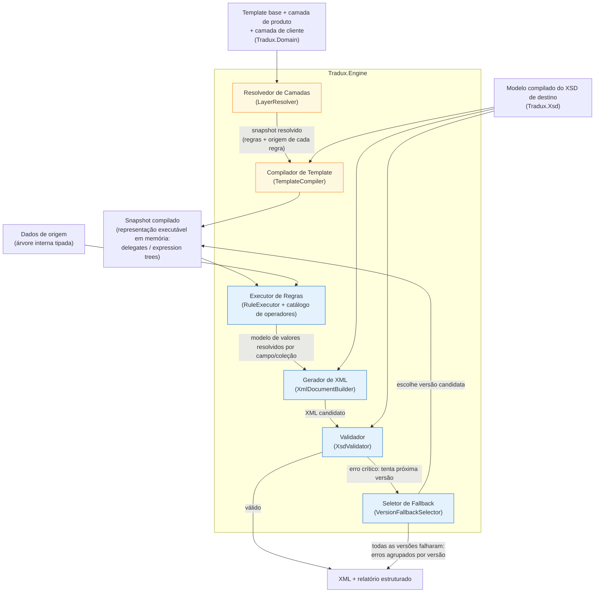

# Componentes (C4 nível 3)

> Status: preenchido na Fase 1, para `Tradux.Engine`. Fonte normativa:
> `docs/requirements/PROMPT_MESTRE_CLAUDE.md` seções 13 a 18 (motor de
> regras, coleções, geração de XML, camadas/versionamento, fallback, erros).
> Ver `docs/architecture/CONTAINERS.md` para a regra de dependência que
> continua valendo aqui: nenhum componente abaixo referencia ASP.NET Core,
> MongoDB ou o editor web — tudo aqui vive dentro de `Tradux.Engine`,
> que só depende de `Tradux.Domain` e `Tradux.Xsd`.

## Visão geral

`Tradux.Engine` tem duas responsabilidades temporais bem distintas,
que os componentes abaixo refletem:

1. **Tempo de publicação/compilação** (acontece quando um template é
   publicado ou quando um snapshot é carregado a frio): resolver camadas,
   compilar o template resolvido em uma representação executável.
2. **Tempo de execução/geração** (acontece a cada chamada de geração, com
   snapshot já compilado, idealmente em cache): executar regras, gerar XML,
   validar, aplicar fallback entre versões candidatas.

Essa separação é o que permite a meta de performance da seção 25 do
requisito de origem (nenhuma recompilação nem leitura de MongoDB por
geração com cache aquecido) e é tratada com mais detalhe em ADR dedicado de
formato de template/camada (Fase 1).

## Diagrama



## Componentes

### Resolvedor de Camadas (`LayerResolver`)

- **Responsabilidade**: dado um template-base da prefeitura, uma camada de
  produto e uma camada de cliente, produz um único **snapshot resolvido**
  em memória, aplicando a ordem base → produto → cliente (seção 16). Cada
  regra do snapshot resolvido carrega a informação de qual camada a
  originou, para que a resolução seja explicável ("toda decisão de
  resolução pode ser explicada", gate da Fase 7).
- **Quando roda**: em tempo de publicação (quando o snapshot imutável é
  materializado) — não em tempo de geração. Em runtime, o Engine consome
  diretamente o snapshot já resolvido e compilado; ele nunca refaz essa
  resolução por chamada.
- **Interface pública (indicativa, sujeita a ADR de formato de
  template/camada)**:
  ```csharp
  public interface ILayerResolver
  {
      LayerResolutionResult Resolve(
          TemplateBaseSnapshot baseTemplate,
          ProductLayer? productLayer,
          ClientLayer? clientLayer);
  }
  ```
  `LayerResolutionResult` contém a árvore de mapeamentos/regras resolvida e,
  por regra, a origem (`Base` | `Produto` | `Cliente`) e eventuais conflitos
  detectados.

### Compilador de Template (`TemplateCompiler`)

- **Responsabilidade**: transformar o snapshot **resolvido** (árvore de
  mapeamentos, condições, operadores e blocos de iteração ainda como dados/
  configuração) em uma **representação executável** — delegates ou
  expression trees compilados (`Expression<T>.Compile()` ou equivalente).
  Esta é a responsabilidade central que fixa a restrição de projeto já
  decidida: **o motor compila o template publicado uma vez e reutiliza a
  representação compilada em toda geração seguinte; ele não interpreta a
  árvore de regras a cada execução.** Interpretar a árvore por chamada
  violaria a meta de performance da seção 25 (templates e XSDs
  pré-compilados) e o gate de cache da Fase 5 (execução com cache aquecido
  não deve pagar custo de recompilação nem de leitura de configuração bruta).
- **Quando roda**: em tempo de publicação, e também na primeira carga a
  frio de um snapshot que ainda não está em cache (cache miss). O resultado
  é o que fica armazenado na camada de cache (fora do Engine — cache é
  responsabilidade de `Application`/`Infrastructure`; o Engine só produz o
  artefato compilado, não a fonte de dados de cache).
- **Interface pública (indicativa)**:
  ```csharp
  public interface ITemplateCompiler
  {
      CompiledTemplate Compile(
          LayerResolutionResult resolved,
          CompiledXsdModel targetSchema);
  }
  ```
  `CompiledTemplate` expõe apenas o necessário para o Executor de Regras e o
  Gerador de XML consumirem (delegates tipados por caminho de destino); não
  expõe a árvore de configuração original.

### Executor de Regras (`RuleExecutor`)

- **Responsabilidade**: aplicar, para um dado de entrada específico, o
  `CompiledTemplate` já compilado — resolvendo condições, grupos lógicos
  (`E`/`OU`/negação), transformações, lookups, `for each`/filtros/listas
  aninhadas — usando o catálogo tipado e extensível de operadores da seção
  13 (`equals`, `notEquals`, `isEmpty`, `and`, `or`, `not`, `copy`,
  `constant`, `coalesce`, `concat`, `substring`, `replace`, `trim`,
  `padLeft`, `padRight`, `formatDate`, `formatNumber`, `lookup`, `omit`,
  `setNull`, `setDefault`, entre outros). Produz um modelo intermediário de
  valores resolvidos por campo/coleção de destino, com diagnóstico por
  regra e caminho (seção 18), sem nenhuma execução de código arbitrário do
  usuário (seção 12 e 28).
- **Extensibilidade**: novos operadores são adicionáveis por desenvolvedores
  via um catálogo registrável, sem alterar o núcleo do executor — cada
  operador declara tipos aceitos, retorno, parâmetros, validações, código de
  erro e compatibilidade com coleções (seção 13).
- **Interface pública (indicativa)**:
  ```csharp
  public interface IRuleExecutor
  {
      RuleExecutionResult Execute(
          CompiledTemplate template,
          SourceDataTree input,
          ExecutionContext context);
  }
  public interface IRuleOperator
  {
      string Name { get; }
      OperatorSignature Signature { get; }
      OperatorResult Evaluate(OperatorArguments args);
  }
  ```

### Gerador de XML (`XmlDocumentBuilder`)

- **Responsabilidade**: construir o documento XML **diretamente a partir do
  modelo compilado do XSD de destino**, nunca por XML-base fixo nem
  concatenação de string (seção 15). Garante ordem dos elementos,
  namespaces e prefixos consistentes, atributos, obrigatórios, omissão de
  opcionais, nulabilidade, repetições, ramos de `choice`, conversão
  invariante à cultura e codificação (UTF-8 padrão, configurável). Consome
  o modelo de valores resolvidos produzido pelo Executor de Regras e o
  `CompiledXsdModel` fornecido por `Tradux.Xsd`.
- **Interface pública (indicativa)**:
  ```csharp
  public interface IXmlDocumentBuilder
  {
      XmlBuildResult Build(
          RuleExecutionResult resolvedValues,
          CompiledXsdModel targetSchema);
  }
  ```

### Validador (`XsdValidator`)

- **Responsabilidade**: validar o XML candidato contra o **conjunto exato
  de XSDs da versão de template utilizada** (não um XSD genérico) — seção
  15 e 28 ("todo XML liberado passa pelo XSD correto"). Classifica achados
  por severidade (informação, aviso, crítico), sendo que falhas de XSD,
  conversão, cardinalidade, compilação e execução são sempre críticas
  (seção 18).
- **Interface pública (indicativa)**:
  ```csharp
  public interface IXsdValidator
  {
      ValidationReport Validate(
          XmlBuildResult candidate,
          CompiledXsdModel exactSchemaSet);
  }
  ```

### Seletor de Fallback (`VersionFallbackSelector`)

- **Responsabilidade**: orquestrar a política de versões candidatas (seção
  17): ler a lista ordenada de versões, tentar a mais nova primeiro,
  disparar compilação/execução/geração/validação para cada candidata em
  ordem, parar na primeira que gerar e validar com sucesso localmente, e —
  se todas falharem — retornar erros agrupados por versão. Importante: este
  componente decide **apenas** com base no que o próprio motor consegue
  gerar e validar localmente; ele não descobre o que um endpoint remoto
  aceita e não implementa reenvio remoto (regra reforçada em `CLAUDE.md` e
  seção 2 do requisito de origem).
- **Interface pública (indicativa)**:
  ```csharp
  public interface IVersionFallbackSelector
  {
      GenerationResult GenerateWithFallback(
          IReadOnlyList<TemplateVersionReference> candidateVersionsDescending,
          SourceDataTree input,
          ExecutionContext context);
  }
  ```
  `GenerationResult` é o contrato de saída completo descrito na seção 18:
  sucesso, XML quando válido, versão usada, versões tentadas, e por
  ocorrência — código estável, mensagem, origem, XPath de destino, regra
  responsável, sugestão e duração. Este é o mesmo formato que
  `Tradux.Contracts` expõe para SDK e API (ver `docs/api/`), sem
  tradução ou duplicação de estrutura entre as duas fachadas.

## Fluxo ponta a ponta (tempo de execução, com snapshot já compilado)

1. `VersionFallbackSelector` recebe a lista de versões candidatas e a
   entrada de dados.
2. Para a versão corrente, obtém o `CompiledTemplate` (já compilado,
   idealmente vindo de cache — a origem do cache é responsabilidade de
   `Application`/`Infrastructure`, fora do Engine).
3. `RuleExecutor` aplica o `CompiledTemplate` sobre os dados de entrada e
   produz o modelo de valores resolvidos, com diagnóstico por regra.
4. `XmlDocumentBuilder` constrói o XML a partir desse modelo e do
   `CompiledXsdModel` da mesma versão.
5. `XsdValidator` valida o XML contra o conjunto exato de XSDs dessa
   versão.
6. Se válido, `VersionFallbackSelector` retorna sucesso com essa versão. Se
   crítico, tenta a próxima versão candidata (volta ao passo 2). Se todas
   as versões se esgotarem, retorna falha com erros agrupados por versão.

## Fora de escopo deste documento

- Componentes de `Tradux.Application` (casos de uso de orquestração,
  cache, invalidação) — pertencem ao container de Aplicação, não ao Engine,
  e serão detalhados quando o ADR de cache/invalidação (Fase 1) e a Fase 5
  avançarem.
- Componentes de `Tradux.Xsd` (parser/importador de XSD, resolução de
  `include`/`import`, modelo canônico de schema) — merecem um C4 nível 3
  próprio quando a Fase 3 (XSD completo) for detalhada; aqui ele aparece
  apenas como dependência consumida pelo Engine (`CompiledXsdModel`).
- Formato interno exato de `CompiledTemplate` (estrutura de delegates,
  estratégia de cache de expression trees) — decisão de implementação da
  Fase 2/5, não deste diagrama de componentes.
