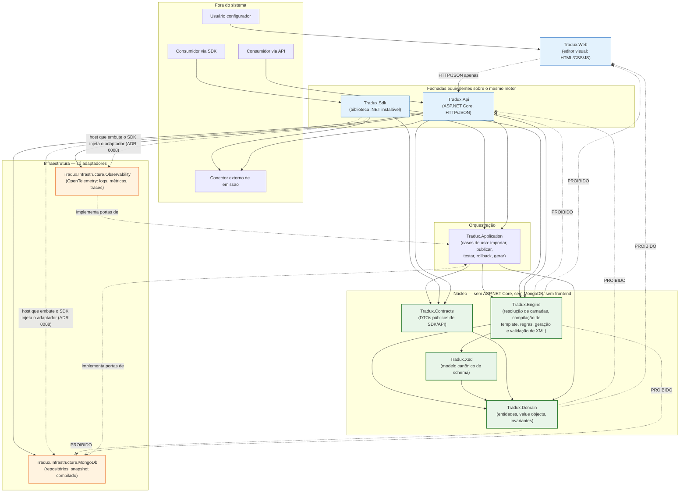

# Containers (C4 nível 2)

> Status: preenchido na Fase 1. Fonte normativa:
> `docs/requirements/PROMPT_MESTRE_CLAUDE.md` seção 8 (estrutura de
> solução sugerida) e seção 2 (limites obrigatórios do núcleo). Ver também
> `CLAUDE.md` → "Arquitetura essencial" e `.claude/rules/dotnet.md`.

## Regra mais importante deste documento

**`Tradux.Domain` e `Tradux.Engine` nunca apontam para
`Tradux.Infrastructure.MongoDb`, `Tradux.Api` ou
`Tradux.Web`.** Nenhuma seta no diagrama abaixo sai de Domínio ou
Motor em direção a esses três containers, em nenhuma circunstância. Isso é o
que torna o núcleo testável, portátil e reutilizável entre SDK e API sem
duplicar lógica de geração. Qualquer proposta de código, PR ou ADR futura
que introduza essa dependência (mesmo indireta, via `Application` ou via
injeção de tipos concretos) deve ser rejeitada nesta fase de revisão de
arquitetura, antes de virar código.

## Diagrama

Leitura do diagrama: as arestas tracejadas terminadas em `x` e rotuladas
"PROIBIDO" não são parte da arquitetura — existem apenas como lembrete
visual explícito do que **nunca** deve ser desenhado ou codificado entre
Domínio/Motor e Infraestrutura/API/Web. Nenhum projeto de código deve conter
essas referências, nem mesmo por conveniência de `using`/`ProjectReference`.

## Tabela de containers

| Container | Projeto(s) | Depende de | Nunca depende de |
|---|---|---|---|
| Domínio | `Tradux.Domain` | nada | ASP.NET Core, MongoDB, `Tradux.Web`, `Tradux.Api`, `Tradux.Infrastructure.*` |
| Modelo de XSD | `Tradux.Xsd` | Domínio | idem acima |
| Motor de mapeamento/geração | `Tradux.Engine` | Domínio, Xsd | ASP.NET Core, MongoDB, Web, Api, Infrastructure.* |
| Contratos públicos | `Tradux.Contracts` | Domínio | Engine, Application, Infrastructure.* (contratos são estáveis e não devem puxar implementação) |
| Aplicação (casos de uso) | `Tradux.Application` | Domínio, Engine, Contracts | MongoDB concreto, ASP.NET Core, Web (depende de portas/interfaces, não de adaptadores) |
| Persistência | `Tradux.Infrastructure.MongoDb` | Domínio, Application (implementa as portas de repositório definidas lá) | Engine (não é referenciado por Engine; apenas referencia tipos de Domínio para (de)serializar) |
| Observabilidade | `Tradux.Infrastructure.Observability` | Application (implementa portas de telemetria) | Engine, Domínio |
| SDK público | `Tradux.Sdk` | Application, Engine, Contracts (nunca Infrastructure.* — o host injeta o repositório, ADR-0008) | Web, Infrastructure.*, Api |
| API HTTP | `Tradux.Api` | Application, Engine, Contracts, Infrastructure.MongoDb, Infrastructure.Observability | — (é o topo da árvore de dependência do lado servidor) |
| Editor web | `Tradux.Web` | Api, **apenas via HTTP/JSON**, nunca via `ProjectReference` | Domain, Engine, Application, qualquer projeto .NET interno |

## Por que essa direção de dependência

- **Domínio e Motor primeiro**: são o ativo mais valioso e mais estável do
  sistema (regras fiscais, compilação de template, geração/validação de
  XML). Se dependessem de MongoDB ou ASP.NET Core, qualquer troca de banco
  ou de framework web forçaria reescrever o motor — o oposto do que Clean
  Architecture pede e do que o requisito de origem exige explicitamente
  (seção 8: "O domínio e o motor não podem depender de ASP.NET Core,
  MongoDB ou frontend").
- **Application como orquestrador, não como motor paralelo**: `Application`
  coordena casos de uso (importar contrato, publicar template, gerar XML)
  chamando `Engine`, mas não reimplementa nenhuma regra de geração. Ela
  depende de *portas* (interfaces) para persistência e observabilidade;
  quem implementa essas portas são os projetos `Infrastructure.*`, nunca o
  contrário.
- **SDK e API como fachadas gêmeas**: ambos dependem exatamente dos mesmos
  `Application`/`Engine`/`Contracts`. Nenhuma lógica de geração vive dentro
  de `Sdk` ou `Api` — eles apenas adaptam entrada/saída (chamada de método
  C# vs. HTTP/JSON) e, no caso da API, resolvem as portas de infraestrutura
  via injeção de dependência. Isso garante o critério de aceite "SDK e API
  usam o mesmo motor" (seção 28).
- **Web fala HTTP, não referência de projeto**: o editor visual (Fase 6) é
  um consumidor comum da API, arquiteturalmente equivalente a qualquer outro
  "Consumidor via API" do `SYSTEM_CONTEXT.md`. Isso evita qualquer tentação
  de o frontend "atalhar" chamando `Engine` diretamente.
- **MongoDB só por adaptadores**: `Infrastructure.MongoDb` conhece
  documentos, índices e o formato do snapshot compilado, mas implementa
  interfaces que `Domain`/`Application` definem. O caminho normal de
  geração com cache aquecido não deve tocar em `Infrastructure.MongoDb`
  (seção 21) — isso só é possível porque `Engine` nunca depende dele para
  começar.

## Protocolos de comunicação entre containers

- Configurador → Web: HTTP(S) via navegador.
- Web → Api: HTTP/JSON (OpenAPI), mesma superfície usada por qualquer
  consumidor externo via API.
- Consumidor via SDK → Sdk: chamada de método em processo (.NET), sem rede.
- Sdk/Api → Application/Engine: chamada de método em processo (mesmo
  binário ou mesmo processo de execução; não há rede interna).
- Api/Sdk (host embutido) → Infrastructure.MongoDb: driver MongoDB oficial,
  encapsulado atrás de interfaces de repositório.
- Api/Sdk → Infrastructure.Observability: OpenTelemetry SDK (exportadores
  configuráveis; produto final de exportação é decisão de operação, não
  deste documento).
- Sdk/Api → Conector externo: não é uma chamada ativa; o núcleo apenas
  retorna XML + relatório estruturado para quem o chamou. É o consumidor
  quem decide encaminhar essa saída ao conector externo.

## Decisões explicitamente fora deste documento

Topologia de deploy, formato exato do documento MongoDB para snapshot
compilado, estratégia de cache/invalidação e versão .NET/ASP.NET Core
adotada são tratadas em ADRs dedicados (`docs/architecture/adrs/`), não
neste diagrama de containers.
