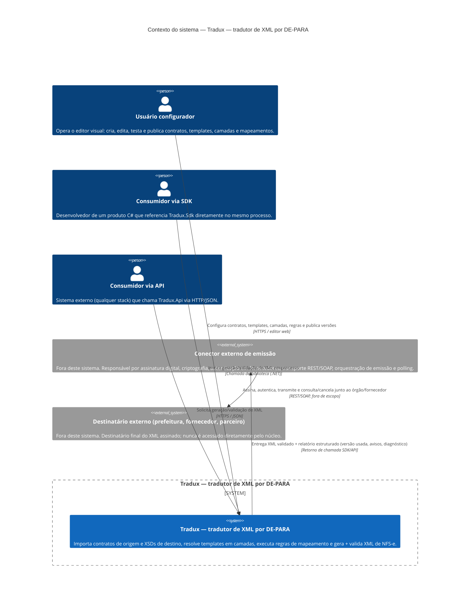

# Contexto do sistema (C4 nível 1)

> Status: preenchido na Fase 1. Fonte normativa:
> `docs/requirements/PROMPT_MESTRE_CLAUDE.md` (seções 2, 7, 8, 9, 28).
> Qualquer mudança de escopo aqui deve ser refletida também em
> `docs/DECISIONS.md`.

## Diagrama

## Atores

- **Usuário configurador**: pessoa que usa o editor visual (`Tradux.Web`,
  Fase 6) para importar contratos de origem, montar o DE-PARA entre a árvore
  de origem e o XSD de destino, definir regras, camadas de produto/cliente,
  rodar testes e publicar versões de template. Não escreve JSON nem código
  diretamente — a interface é orientada a árvore/formulário (seção 12 do
  requisito de origem).
- **Consumidor via SDK**: aplicação C# que referencia `Tradux.Sdk` como
  biblioteca e chama o motor em processo, sem HTTP. Usado quando o produto
  consumidor já roda em .NET e quer evitar um salto de rede.
- **Consumidor via API**: qualquer sistema, independente de linguagem, que
  chama `Tradux.Api` (ASP.NET Core) via HTTP/JSON. SDK e API são
  fachadas equivalentes sobre o mesmo motor — nunca duas implementações de
  geração (regra inegociável, seção 1 e 28 do requisito de origem).
- **Conector externo de emissão** (fora do sistema): consome a saída deste
  sistema (XML validado + relatório) e é responsável por tudo que o núcleo
  explicitamente não faz: assinatura digital, criptografia, armazenamento de
  certificados/chaves, autenticação junto a fornecedores, chamadas
  REST/SOAP, orquestração síncrona/assíncrona de emissão e polling/consulta
  de lote (seção 2 do requisito de origem). Este ator existe no diagrama
  apenas para deixar a fronteira explícita; nenhum código deste repositório
  o implementa.
- **Destinatário externo (prefeitura, fornecedor, parceiro)** (fora do sistema): destinatário final
  do XML. Só é alcançado através do conector externo; a plataforma nunca
  estabelece essa comunicação diretamente.

## Fronteira exata do sistema

O sistema começa em: dados de origem (JSON ou objeto C#) + identificação de
organização, template, operação e política de versão. Dentro da fronteira,
ele:

1. Carrega o contrato de origem (módulos versionados) e o schema de destino
   (XSD/pacote de XSDs) relevantes.
2. Resolve o template publicado através de suas camadas (base → produto →
   cliente) em um snapshot imutável.
3. Executa mapeamentos, condições, transformações e iterações sobre os
   dados de entrada.
4. Constrói o XML diretamente a partir do modelo compilado do XSD de
   destino (nunca por concatenação de string nem XML-base fixo).
5. Valida o XML gerado contra o conjunto exato de XSDs da versão utilizada,
   tentando versões candidatas segundo a política de fallback configurada.

O sistema **termina** ao devolver: o XML válido (quando houver sucesso), a
versão de template efetivamente usada, a lista de versões tentadas, e um
relatório estruturado (avisos, erros críticos, diagnóstico por regra/caminho
XPath, duração). Ele nunca assina, criptografa, transmite, autentica junto a
terceiros ou faz polling — essas responsabilidades começam exatamente onde a
fronteira deste sistema termina, do lado do "conector externo de emissão".
Essa linha é a mesma descrita em `CLAUDE.md` ("Limites obrigatórios do
núcleo") e na seção 2 do requisito de origem; qualquer proposta de desenho
que a cruze deve ser tratada como violação de escopo, não como detalhe de
implementação.

## Fora de escopo deste diagrama

- Protocolo exato de autenticação entre consumidores e a API (tratado em
  ADR de segurança/autorização, Fase 1/9).
- Topologia de deploy (quantas instâncias, load balancer) — não há decisão
  de infraestrutura de runtime nesta fase; o requisito apenas exige runtime
  sem estado, escalável horizontalmente (seção 7).
- Filas ou mensageria — não introduzidas sem evidência de necessidade
  (seção 25), portanto não aparecem no contexto.
