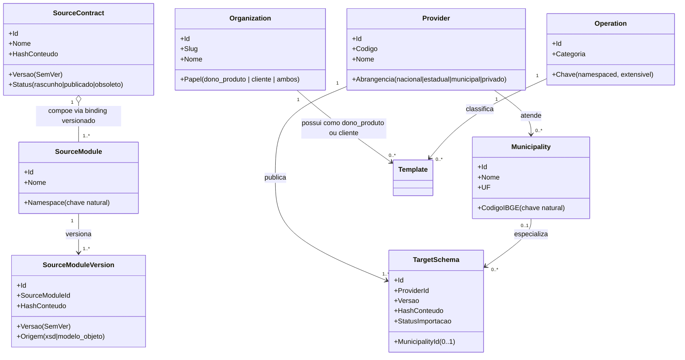
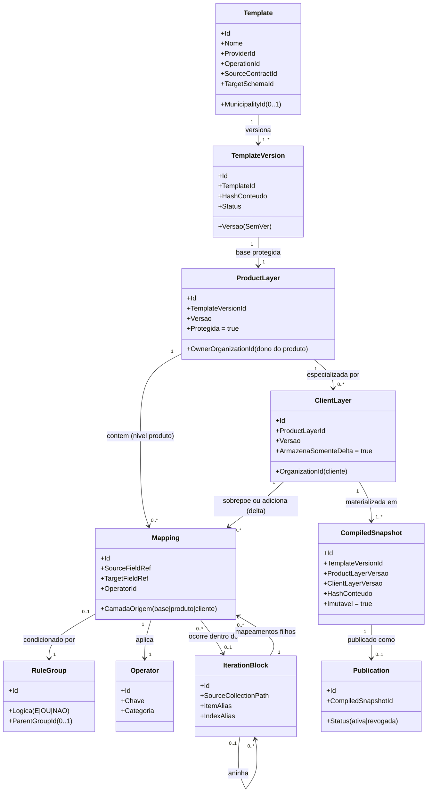
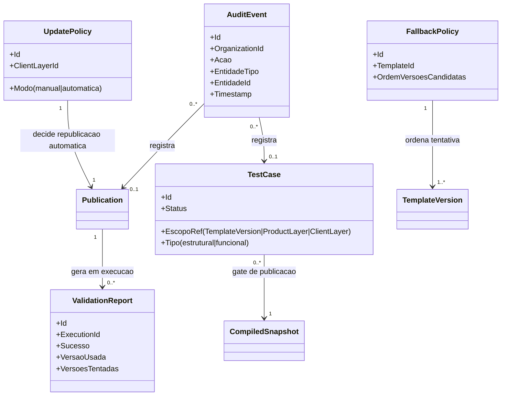

# Modelo de domínio — Tradux — tradutor de XML por DE-PARA

> Fonte normativa: `docs/requirements/PROMPT_MESTRE_CLAUDE.md`, seções 9
> (modelo mínimo), 10 (contratos de origem), 16 (camadas/publicação) e 17
> (versionamento/fallback). Termos usados aqui seguem `docs/GLOSSARY.md`.

## 0. Escopo deste documento

Este é um **modelo conceitual/de dados**, para orientar a implementação das
Fases 2+. Ele define entidades, atributos, identidade estável e relações —
não código C#, não estrutura interna de XSD.

Explicitamente fora de escopo aqui:

- A árvore interna tipada de um XSD específico (elementos, tipos, `sequence`/
  `choice`/`all`, patterns) — isso é fixture/análise de schema, documentada em
  `docs/schemas/` pelo próprio agente `domain-xsd` em outro artefato, não
  neste modelo de domínio.
- Assinaturas de classes/interfaces C#, contratos de API/SDK — isso é da Fase
  2+ e de `docs/api/`.
- Controles de segurança de importação de XSD (referência externa, path
  traversal, XXE, limites de pacote) — a obrigação existe (seção 11 do
  requisito de origem) e é referenciada onde relevante (§3.5, §3.4), mas o
  desenho de mitigação/threat model pertence a `docs/architecture/` ou
  `docs/operations/`, de responsabilidade do agente `security-observability`.

## 1. Convenções de identidade e versionamento

Usadas de forma consistente em todas as entidades abaixo:

- **Id (surrogate)**: identificador técnico estável, opaco, nunca reciclado
  (ex.: ULID/GUID). Usado em todas as relações internas.
- **Chave natural**: identificador legível/estável do ponto de vista de
  negócio (ex.: namespace de módulo, código IBGE de município, chave de
  operação). Documentada por entidade quando existir.
- **Versão imutável**: uma vez publicada/selada, uma versão nunca é
  alterada — qualquer mudança gera uma nova versão. Aplica-se a Contrato de
  origem, Módulo de origem, Schema de destino, Versão de template, Camada de
  produto, Camada de cliente e Snapshot compilado.
- **SemVer**: `MAJOR.MINOR.PATCH` para módulos e templates. Compatibilidade
  declarada como *range* (ex.: `1.x`) em pontos de composição — ver §4.
- **Hash de conteúdo**: SHA-256 (ou equivalente) do conteúdo canônico,
  calculado no momento em que uma versão é selada. Usado para: detectar
  divergência entre ambientes, garantir reprodutibilidade de pacote (seção
  22 do requisito de origem) e como parte da identidade de Schema de destino,
  Versão de módulo e Snapshot compilado.
- **Tenant-scoping**: toda entidade que não seja compartilhada entre
  organizações (camada de produto, camada de cliente, publicação, relatório
  de validação, evento de auditoria) carrega um campo de organização
  explícito e não anulável. Camada de produto usa `OwnerOrganizationId`
  (dono do produto — protege quem pode editá-la, ver §3.11); camada de
  cliente, publicação, relatório de validação e evento de auditoria usam
  `OrganizationId` (a organização que os criou/possui). Apenas entidades de
  plataforma verdadeiramente sem dono de tenant (fornecedor, município,
  operação, schema de destino) não carregam nenhum desses campos. Esta
  distinção é um controle de isolamento multiempresa classificado como
  crítico em `docs/operations/THREAT_MODEL.md` (TM-01) — nunca trate camada
  de produto como "compartilhada e sem organização".

## 2. Diagramas gerais

### 2.1 Tenants, contratos de origem e destino



### 2.2 Cadeia de resolução de template



### 2.3 Qualidade, execução e governança



## 3. Entidades

Cada entidade lista: **Atributos principais**, **Identidade** (como é
referenciada de forma estável/versionada) e **Relações**.

### 3.1 Organização / Tenant

- **Atributos**: nome, slug único, papel (dono de produto, cliente, ou
  ambos — uma organização pode ser dona de produto para alguns templates e
  cliente de outra em outros), status (ativa/suspensa).
- **Identidade**: `Id` surrogate; `Slug` como chave natural estável usada em
  URLs/config, nunca reciclada mesmo se a organização for desativada.
- **Relações**: dona de zero ou mais `Camada de produto` (quando papel
  produto); dona de zero ou mais `Camada de cliente` (quando papel cliente);
  origem de `Evento de auditoria`; escopo de isolamento (tenant) para toda
  entidade não-compartilhada.

### 3.2 Contrato de origem (`SourceContract`)

- **Atributos**: nome, versão (SemVer do contrato como um todo), status
  (rascunho/publicado/obsoleto), lista de *bindings* de módulo (ver §4),
  hash de conteúdo agregado, descrição.
- **Identidade**: `Id` surrogate + `Versao`. Imutável após publicado — uma
  mudança nos módulos componentes gera uma nova versão do contrato.
- **Relações**: composto por 1..N `Módulo de origem` através de um binding
  versionado (`SourceContractModuleBinding`, ver §4); referenciado por
  `Template` (um template aponta para um `SourceContract` + versão
  específica ou faixa aceitável, resolvida via `Política de fallback`).

### 3.3 Módulo de origem (`SourceModule`)

- **Atributos**: nome, namespace (obrigatório, conforme seção 10 do
  requisito de origem), descrição, origem admitida (`xsd` ou
  `modelo_objeto` configurável).
- **Identidade**: `Id` surrogate; `Namespace` é a chave natural estável —
  não muda entre versões do módulo.
- **Relações**: possui 1..N `Versão de módulo`; referenciado por bindings de
  `Contrato de origem`.

### 3.4 Versão de módulo (`SourceModuleVersion`)

- **Atributos**: versão (SemVer), hash de conteúdo, tipo de origem (pacote
  XSD ou schema de objeto/JSON), status de importação (importado, validado,
  rejeitado), metadados de proveniência (arquivo original, data de
  importação, ator responsável).
- **Identidade**: `Id` surrogate + `SourceModuleId` + `Versao`. Imutável
  após selada; o hash de conteúdo é o que garante reprodutibilidade entre
  ambientes (seção 22 do requisito de origem).
- **Relações**: pertence a um `Módulo de origem`; referenciada por bindings
  de `Contrato de origem` (diretamente, quando o contrato fixa uma versão
  exata) ou resolvida em tempo de execução dentro de uma faixa aceita (ex.:
  `dps@1.x` resolve para a maior `SourceModuleVersion` compatível
  disponível — ver §4).
- **Nota de segurança**: a importação do pacote que origina esta versão
  (quando XSD) está sujeita aos controles da seção 11 do requisito de
  origem (bloqueio de referência externa, path traversal, expansão insegura
  de entidades, limites de arquivo/pacote). `StatusImportacao` deve refletir
  rejeição por violação desses controles; o desenho desses controles é do
  `security-observability`/`dotnet-engine`, não deste documento.

### 3.5 Schema de destino (`TargetSchema`)

- **Atributos**: versão, hash de conteúdo do pacote de XSD(s), status de
  importação, `Fornecedor` associado, `Município` associado (opcional — ver
  nota em §7), metadados de proveniência.
- **Identidade**: `Id` surrogate + `Versao` + `HashConteudo`. Imutável após
  selado — a estrutura interna real (árvore tipada de elementos/tipos) é
  detalhe de implementação do motor/fixture, não repetida aqui.
- **Relações**: publicado por um `Fornecedor`; opcionalmente especializado
  por `Município`; referenciado por `Template` (um template gera para
  exatamente um Schema de destino, em uma versão específica ou faixa
  resolvida por fallback).
- **Nota de segurança**: mesma observação de §3.4 — importação segura é
  pré-condição para `StatusImportacao = validado`.

### 3.6 Fornecedor (`Provider`)

- **Atributos**: código, nome, abrangência (nacional — ex.: Ambiente de
  Dados Nacional da NFS-e —, estadual, municipal, ou privado/terceirizado),
  URL/endpoint de referência (apenas documental — o núcleo não chama esse
  endpoint, conforme limites em `CLAUDE.md`).
- **Identidade**: `Id` surrogate; `Codigo` como chave natural legível
  (ex.: `ADN-NACIONAL`, `PREF-SAOPAULO-ISSDIGITAL`).
- **Relações**: atende 0..N `Município`; publica 1..N `Schema de destino`;
  referenciado por `Template`.

### 3.7 Município (`Municipality`)

- **Atributos**: nome, UF, código IBGE.
- **Identidade**: `Id` surrogate; `CodigoIBGE` (7 dígitos) como chave
  natural nacionalmente estável.
- **Relações**: atendido por 0..N `Fornecedor` (tipicamente 1, mas municípios
  podem migrar de fornecedor ao longo do tempo — a migração gera novo
  vínculo, não sobrescreve o antigo); pode especializar `Schema de destino`
  ou `Template` quando o layout do fornecedor exige parametrização por
  município (ex.: tabela de códigos de serviço/ISS locais).

### 3.8 Operação (`Operation`)

Ver §5 para o modelo completo de catálogo aberto. Resumo de atributos:

- **Atributos**: chave namespaced e extensível (ex.: `core.emissao`,
  `core.consulta`, `core.cancelamento`, `core.cancelamentoPorSubstituicao`,
  ou uma chave de terceiro/cliente como `acme.retificacao`), categoria,
  capacidades exigidas (ex.: `exigeDocumentoReferenciado: bool` para
  cancelamento), descrição.
- **Identidade**: `Id` surrogate; `Chave` como chave natural estável e
  única — é o que garante extensibilidade sem enum fechado no código.
- **Relações**: classifica 0..N `Template`.

### 3.9 Template

- **Atributos**: nome, `Provider`, `Município` (opcional), `Operation`,
  `SourceContract` (id + faixa de versão aceita), `TargetSchema` (id + faixa
  de versão aceita), organização dona do produto.
- **Identidade**: `Id` surrogate estável ao longo da vida do template;
  representa a "linha do tempo" — a foto imutável em cada ponto é a
  `Versão de template`.
- **Relações**: possui 1..N `Versão de template`; associado a exatamente um
  `Fornecedor`, uma `Operação`, um `Contrato de origem` e um `Schema de
  destino`; possui uma `Política de fallback`.

### 3.10 Versão de template (`TemplateVersion`)

- **Atributos**: SemVer, hash de conteúdo, status (rascunho, publicada,
  obsoleta), data de selagem, autor.
- **Identidade**: `Id` surrogate + `TemplateId` + `Versao`. Imutável após
  selada.
- **Relações**: é a base para exatamente uma `Camada de produto`; alvo de
  `Caso de teste` estrutural; ordenada dentro da `Política de fallback` do
  template.

### 3.11 Camada de produto (`ProductLayer`)

- **Atributos**: versão, organização dona do produto, conjunto de
  `Mapeamento`/`Grupo de regras`/`Bloco de iteração` construídos sobre a
  `Versão de template` base, status (rascunho/publicada), hash de conteúdo.
- **Identidade**: `Id` surrogate + `Versao`. **Protegida**: apenas a
  organização dona do produto pode editá-la; clientes nunca escrevem aqui
  diretamente (conforme seção 16 do requisito de origem).
- **Relações**: construída sobre 1 `Versão de template`; especializada por
  0..N `Camada de cliente`; contém `Mapeamento`, `Grupo de regras`,
  `Bloco de iteração` no nível "produto".

### 3.12 Camada de cliente (`ClientLayer`)

- **Atributos**: versão, organização cliente, **delta** — apenas
  diferenças e extensões sobre a `Camada de produto` (adições, overrides,
  remoções explícitas de mapeamento — nunca uma cópia completa), status,
  hash de conteúdo, `Política de atualização` vigente.
- **Identidade**: `Id` surrogate + `Versao`. Escopada por
  `OrganizationId` (tenant).
- **Relações**: especializa exatamente 1 `Camada de produto`; materializada
  junto com a camada de produto e a versão de template em 1..N
  `Snapshot compilado`; governada por 1 `Política de atualização`.

### 3.13 Mapeamento (`Mapping`)

- **Atributos**: `SourceFieldRef` e `TargetFieldRef` (cada um com
  `Cardinalidade` e `Nulabilidade` independentes — ver §6), `Operator`
  aplicado e seus parâmetros, `RuleGroup` condicional opcional, camada
  proprietária (base/produto/cliente), tipo de ação quando em camada de
  cliente (`adiciona` | `sobrescreve` | `remove`).
- **Identidade**: `Id` surrogate, único dentro da camada que o declara.
  Quando uma camada de cliente sobrescreve um mapeamento de produto, ela
  referencia o `Id` original do mapeamento de produto (não duplica).
- **Relações**: pertence a uma camada (`ProductLayer` ou `ClientLayer`);
  aplica um `Operator`; condicionado opcionalmente por um `RuleGroup`; pode
  existir dentro de um `IterationBlock` (mapeamento filho) ou no nível raiz
  do template.

### 3.14 Grupo de regras (`RuleGroup`)

- **Atributos**: operador lógico (`E`, `OU`, `NÃO`), lista de condições
  (cada condição referencia um `Operator` de comparação/existência aplicado
  a um `SourceFieldRef`), grupos filhos aninhados.
- **Identidade**: `Id` surrogate, único dentro do `Mapping`/`IterationBlock`
  que o declara.
- **Relações**: pode aninhar outros `RuleGroup` (`ParentGroupId`);
  condiciona 0..N `Mapping` e 0..N `IterationBlock` (usado também como
  filtro de coleção).

### 3.15 Operador (`Operator`)

- **Atributos**: chave estável (ex.: `equals`, `lookup`, `formatDate`),
  categoria (comparação, texto, número, data, conversão, coleção,
  constante/default, omissão, etc. — seção 13 do requisito de origem),
  tipos de entrada aceitos, tipo de retorno, esquema de parâmetros,
  compatibilidade com coleções, origem (`builtin` ou `extensao_customizada`
  com referência ao assembly/plugin que o registra).
- **Identidade**: `Id` surrogate; `Chave` como chave natural estável e
  única no catálogo — novos operadores são adicionados como novas linhas de
  catálogo, sem alterar operadores existentes nem o núcleo do motor
  (extensibilidade exigida pela seção 13).
- **Relações**: aplicado por 1..N `Mapping`; referenciado por condições
  dentro de `RuleGroup`.

### 3.16 Bloco de iteração (`IterationBlock`)

- **Atributos**: caminho da coleção de origem (`SourceCollectionPath`),
  alias do item no contexto local, alias do índice, `RuleGroup` de filtro
  opcional, especificação de ordenação opcional, lista de `Mapping` filhos,
  lista de `IterationBlock` aninhados, cardinalidade esperada no destino
  (`minOccurs`/`maxOccurs` do elemento repetido — ver §6).
- **Identidade**: `Id` surrogate, único dentro da camada/bloco pai que o
  declara.
- **Relações**: contém 0..N `Mapping` filhos; pode aninhar 0..N
  `IterationBlock`; filtrado opcionalmente por 1 `RuleGroup`; pertence a uma
  camada (`ProductLayer` ou `ClientLayer`) ou a um `IterationBlock` pai.

### 3.17 Caso de teste (`TestCase`)

- **Atributos**: tipo (`estrutural` — gerado sinteticamente a partir do
  contrato — ou `funcional` — autoral, com entrada e XML esperado ou
  asserções estruturais), escopo (referencia a `Versão de template`,
  `Camada de produto` ou `Camada de cliente` em que foi definido/é
  obrigatório), resultado da última execução, status (obrigatório para
  publicação ou não).
- **Identidade**: `Id` surrogate, único dentro do escopo que o declara.
- **Relações**: pertence a um escopo de camada/versão; usado como gate de
  `Publication` (nenhuma publicação ocorre com caso de teste obrigatório
  falhando — seção 19/28 do requisito de origem).

### 3.18 Publicação (`Publication`)

- **Atributos**: status (`ativa`/`revogada`), data/hora, ator responsável,
  ambiente (quando aplicável), motivo (quando é rollback).
- **Identidade**: `Id` surrogate. Imutável quanto ao fato histórico —
  revogar não apaga o registro, cria um novo estado/evento.
- **Relações**: publica exatamente 1 `Snapshot compilado`; gera 0..N
  `Relatório de validação` (um por execução em produção usando essa
  publicação); gerada e revogada com `Evento de auditoria` correspondente.

### 3.19 Snapshot compilado (`CompiledSnapshot`)

- **Atributos**: hash de conteúdo, referência exata e imutável a
  `Versão de template` + `Camada de produto` (versão) + `Camada de cliente`
  (versão), resultado materializado e resolvido do conjunto completo de
  `Mapping`/`RuleGroup`/`IterationBlock` (com explicação de origem por
  regra — de qual camada cada regra efetiva veio, conforme seção 16),
  data de compilação.
- **Identidade**: `Id` surrogate + `HashConteudo`. Completamente imutável —
  é a unidade de cache e de execução em produção.
- **Relações**: materializa 1 `Versão de template` + 1 `Camada de produto` +
  1 `Camada de cliente`; gate de `Caso de teste`; alvo de no máximo 1
  `Publication` ativa por vez (histórico de publicações passadas é mantido);
  candidato dentro de uma `Política de fallback`.

### 3.20 Política de atualização (`UpdatePolicy`)

- **Atributos**: modo (`manual` ou `automática`), gatilho (nova versão de
  `Camada de produto` disponível), comportamento em conflito (bloquear e
  exigir revisão manual, sempre — mesmo no modo automático, se houver
  conflito real), exigência de `Caso de teste` passando antes de
  republicar.
- **Identidade**: `Id` surrogate, um registro vigente por `Camada de
  cliente` (histórico de mudanças de política auditado via
  `Evento de auditoria`).
- **Relações**: governa a reação de 1 `Camada de cliente` a uma nova versão
  da `Camada de produto`; decide, quando automática e sem conflito nem
  falha de teste, a criação de nova `Publication`.

### 3.21 Política de fallback (`FallbackPolicy`)

- **Atributos**: lista ordenada de `Versão de template`/`Snapshot
  compilado` candidatos, critério de "erro crítico" que dispara a tentativa
  seguinte (seção 17/18 do requisito de origem: falhas de XSD, conversão,
  cardinalidade, compilação e execução são sempre críticas).
- **Identidade**: `Id` surrogate, um registro vigente por `Template` (ou por
  escopo de execução mais específico, quando necessário — ver ambiguidade
  em §8).
- **Relações**: ordena 1..N `Snapshot compilado`/`TemplateVersion`
  candidatos; consultada a cada execução, produzindo a lista
  `VersoesTentadas` registrada no `Relatório de validação`.

### 3.22 Relatório de validação (`ValidationReport`)

- **Atributos**: sucesso (bool), XML resultante (quando válido), versão
  usada, lista de versões tentadas, lista de diagnósticos — cada um com
  severidade (`Informação`/`Aviso`/`Crítico`), código estável, mensagem,
  origem, XPath de destino, regra responsável, sugestão —, duração total.
- **Identidade**: `Id` surrogate = identificador de execução
  (`ExecutionId`/correlation id). Não é uma entidade versionada de
  configuração; é um registro de resultado de uma execução pontual.
- **Relações**: gerado por uma execução contra 1 `Publication` (snapshot
  ativo) ou, em ambiente de teste, contra 1 `CompiledSnapshot` de rascunho;
  pode originar `Evento de auditoria` quando a execução envolve acesso a
  diagnóstico sensível (seção 20/23 do requisito de origem).

### 3.23 Evento de auditoria (`AuditEvent`)

- **Atributos**: organização, ator (usuário ou processo do sistema), ação
  (criação, edição, teste, publicação, rollback, importação, exportação,
  mudança de permissão, acesso a diagnóstico — conforme `docs/GLOSSARY.md`),
  tipo e id da entidade afetada, timestamp, estado anterior/posterior ou
  diff, motivo/comentário opcional, correlation id.
- **Identidade**: `Id` surrogate, imutável e append-only — nunca editado ou
  apagado.
- **Relações**: referencia opcionalmente qualquer entidade de configuração
  (`Template`, camada, `Publication`, `TestCase`, `SourceModuleVersion`
  etc.) como alvo da ação; escopado sempre por `Organization`.

## 4. Contrato de origem composto por módulos versionados e namespaced

Um `SourceContract` não referencia módulos por uma associação simples — ele
declara uma lista de **bindings**:

```
SourceContractModuleBinding {
  SourceContractId
  SourceModuleId          // chave natural: namespace do módulo, ex. "dps"
  VersionConstraint        // ex.: "1.x", "^2.0", ou versão exata "2.0.3"
  Obrigatorio: bool
}
```

Exemplo prático — um contrato de DPS nacional com anexo opcional de RP
adicional:

```
SourceContract "dps-nacional@3.1"
  ├── binding: modulo "dps"           , constraint "1.x", obrigatorio=true
  └── binding: modulo "rpAdicional"   , constraint "2.0", obrigatorio=false
```

Pontos do modelo:

- O **binding** fixa uma *faixa* de compatibilidade, não necessariamente uma
  `SourceModuleVersion` exata. A resolução para uma versão concreta ocorre
  em dois momentos possíveis, e o modelo permite ambos sem forçar um único
  caminho:
  - **Em tempo de publicação de template**: a `Versão de template`/`Camada
    de produto` pode pinar uma `SourceModuleVersion` concreta dentro da
    faixa, tornando o `CompiledSnapshot` totalmente determinístico.
  - **Em tempo de execução**: quando o binding permanece uma faixa aberta,
    a resolução segue a mesma lógica de tentativa ordenada da `Política de
    fallback` (§3.21) — mais nova compatível primeiro, com fallback para a
    anterior compatível em caso de erro crítico.
- Cada `SourceModule` é identificado de forma estável pelo `Namespace`
  (chave natural), nunca pelo `Id` técnico sozinho — isso é o que permite
  reconhecer `dps` como o mesmo módulo entre `dps@1.0`, `dps@1.1` e
  `dps@1.x` em contratos diferentes.
- A árvore interna tipada e única mencionada na seção 10 do requisito de
  origem (normalização de XSD *e* modelo de objeto configurável em uma
  única representação) é responsabilidade do **motor** (Fase 2+), não deste
  modelo de domínio — aqui modelamos apenas a proveniência/versionamento dos
  módulos que alimentam essa normalização.
- Um módulo pode ter `Origem = xsd` ou `Origem = modelo_objeto`; ambos
  produzem `SourceModuleVersion` com hash de conteúdo, mudando apenas o
  formato de entrada aceito antes da normalização.

## 5. Operação como catálogo aberto

`Operation` **não é um enum fechado no código** — é um catálogo de dados,
com uma tabela/coleção própria, e um `Template` referencia uma operação por
`Chave` (string estável), não por valor de enumeração compilado.

```
OperationDefinition {
  Id
  Chave                         // ex.: "core.emissao"
  Categoria                     // ex.: "emissao" | "consulta" | "cancelamento"
  ExigeDocumentoReferenciado    // bool — true para cancelamento/consulta
  PermiteNovaEmissaoVinculada   // bool — true só para cancelamento por substituicao
  Descricao
}
```

Modelos iniciais (dados de catálogo, não código):

| Chave | Categoria | Exige documento referenciado | Permite nova emissão vinculada |
|---|---|---|---|
| `core.emissao` | emissão | não | não |
| `core.consulta` | consulta | sim (chave de acesso/protocolo) | não |
| `core.cancelamento` | cancelamento | sim (NFS-e original) | não |
| `core.cancelamentoPorSubstituicao` | cancelamento | sim (NFS-e original) | sim (nova NFS-e substituta) |

Como uma operação nova é adicionada **sem alterar o núcleo**:

1. Inserir uma nova linha em `OperationDefinition` com uma `Chave` inédita
   (por convenção, namespaced — `core.*` reservado à plataforma,
   `<organizacao>.*` para operações específicas de um cliente/fornecedor,
   ex.: `sp-issdigital.retificacaoParcial`).
2. Criar um `Template` que referencia essa `Chave`, com seu próprio
   `SourceContract` e `TargetSchema`.
3. O motor de geração e o modelo de `Mapping`/`RuleGroup`/`IterationBlock`
   não têm nenhuma lógica condicionada a valores específicos de operação —
   eles operam sobre o template resolvido independentemente de qual
   operação ele representa. Qualquer comportamento realmente específico de
   uma categoria de operação (ex.: exigir referência a documento anterior)
   é modelado como **regra de validação de negócio declarada no template**
   (usando `RuleGroup`/`Operator`), não como `if (operacao == X)` no núcleo.
4. Nenhuma migração de schema de banco nem recompilação do motor é
   necessária — apenas um novo registro de catálogo e um novo template.

## 6. Cadeia de resolução: template-base → produto → cliente → snapshot

Modelo de dados (não implementação) da seção 16 do requisito de origem:

| Camada | O que armazena | Quem edita | Mutabilidade |
|---|---|---|---|
| `TemplateVersion` (base) | Estrutura selada do template: `SourceContract` + `TargetSchema` associados, metadados. Não contém mapeamentos de negócio — é o "esqueleto" contratual. | Time de plataforma/arquitetura de schema | Imutável após selado |
| `ProductLayer` | Conjunto **completo** de `Mapping`, `RuleGroup`, `IterationBlock` que implementam o DE-PARA padrão para aquele fornecedor/operação. Protegida — é o produto vendido. | Organização dona do produto | Nova versão a cada mudança; anteriores preservadas |
| `ClientLayer` | Apenas o **delta**: lista de operações `adiciona` (novo mapeamento/regra que não existe no produto), `sobrescreve` (referencia `Id` do mapeamento de produto e fornece novo valor/operador), `remove` (referencia `Id` do mapeamento de produto e marca como suprimido para este cliente). Nunca uma cópia integral da camada de produto. | Organização cliente (ou plataforma em nome do cliente) | Nova versão a cada mudança; anteriores preservadas |
| `CompiledSnapshot` | Resultado **materializado** de aplicar o delta da `ClientLayer` sobre a `ProductLayer` sobre a `TemplateVersion` — todo mapeamento efetivo, resolvido, com rastro de qual camada o originou (`OrigemCamada: base_estrutura | produto | cliente_delta`). É o que o motor de execução realmente lê. | Gerado automaticamente na publicação, nunca editado à mão | Totalmente imutável |
| `Publication` | Qual `CompiledSnapshot` está ativo agora (e histórico de quais estiveram). | Ato de publicar (manual ou automático via `UpdatePolicy`) | Estado ativo é único por vez; histórico preservado |

Regras de resolução refletidas no modelo:

- A explicabilidade exigida ("a resolução deve explicar a origem de cada
  regra") é um **atributo do próprio `CompiledSnapshot`**: cada mapeamento
  efetivo carrega `OrigemCamada` e, quando aplicável, o `Id` do mapeamento
  de produto que foi sobrescrito ou removido — não é algo recalculado a
  posteriori.
- Rollback é modelado como **trocar qual `CompiledSnapshot` está referenciado
  por uma `Publication` ativa** para um snapshot anterior já existente —
  nunca como edição do snapshot atual nem exclusão de histórico.
- Falha de atualização (testes falhando ou conflito detectado no modo
  automático) nunca produz um novo `CompiledSnapshot` publicado — o modelo
  não permite `Publication` apontar para um `CompiledSnapshot` cujos
  `TestCase` obrigatórios não passaram.

## 7. Fornecedor × Município — nota de modelagem

O requisito de origem não detalha a cardinalidade exata entre Fornecedor,
Município e Template. Este modelo assume (ver ambiguidade registrada em
§8): um `Template` associa-se a exatamente um `Provider` e,
**opcionalmente**, a um `Municipality` específico — cobrindo dois casos
reais:

- **Layout nacional/estadual único**: um `Provider` (ex.: ADN nacional)
  atende muitos municípios com o mesmo `TargetSchema`/`Template` — nesse
  caso `Template.MunicipalityId` é nulo (o template não é específico de
  município).
- **Layout próprio de prefeitura**: um `Provider` representa o webservice
  de uma prefeitura específica — nesse caso `Template.MunicipalityId` é
  preenchido, e tipicamente há uma única `Municipality` associada àquele
  `Provider`.

Quando um layout nacional exige parametrização por município (ex.: tabela
local de códigos de serviço/ISS), isso é modelado como diferença de
**camada de produto ou de cliente** (uma `ProductLayer`/`ClientLayer` por
município, todas construídas sobre a mesma `TemplateVersion` base) — não
como um novo `Template` por município.

## 8. Opcional (cardinalidade) × aceita nulo (nulabilidade)

Regra permanente do domínio (nunca relaxar, conforme seção 11 do requisito
de origem): **um campo pode ser opcional e não aceitar nulo, obrigatório e
aceitar nulo, ou qualquer outra combinação — são dois eixos independentes.**

Sempre que um `Mapping` referencia um campo de schema (origem ou destino),
a referência é modelada como um par de eixos independentes, não como um
único booleano "é opcional":

```
SchemaFieldReference {
  Path                    // referência estável ao campo no contrato/schema
  DataType
  Cardinalidade {
    MinOccurs             // 0 = opcional (pode estar ausente), 1+ = obrigatório
    MaxOccurs             // 1 = escalar, >1 ou "ilimitado" = coleção
  }
  Nulabilidade {
    AceitaNulo: bool       // equivalente a nillable=true em XSD — elemento
                            // pode estar presente com xsi:nil="true"/valor nulo
  }
}
```

Consequências explícitas no modelo:

- `MinOccurs=0, AceitaNulo=false`: campo pode estar **ausente**, mas se
  presente, nunca pode ser nulo/vazio-marcado — caso mais comum de campo
  opcional simples.
- `MinOccurs=1, AceitaNulo=true`: campo **sempre precisa aparecer** no XML
  (obrigatório), mas seu conteúdo pode ser explicitamente nulo
  (`xsi:nil="true"`) — combinação frequentemente esquecida por
  implementações ingênuas que tratam "obrigatório" como "precisa ter
  valor".
- `MinOccurs=0, AceitaNulo=true`: campo pode estar ausente **ou** presente e
  nulo — duas formas distintas de "não informado" que podem ter significado
  fiscal diferente dependendo do schema de destino.
- `MinOccurs=1, AceitaNulo=false`: caso mais restritivo — sempre presente,
  sempre com valor.
- Um `Mapping` precisa reconciliar o par de `SchemaFieldReference` de
  origem e destino de forma independente em cada eixo: por exemplo, uma
  origem opcional-não-nulável (campo ausente no objeto de entrada) mapeada
  para um destino obrigatório-nulável exige uma estratégia explícita
  (`Operator` de categoria "omissão"/"default"/"setNull" — seção 13 do
  requisito de origem) declarada no próprio `Mapping`, nunca inferida
  implicitamente pelo motor.
- Para contratos de origem do tipo `modelo_objeto` (JSON/C#, sem XSD), o
  mesmo par de eixos se aplica por analogia: `Cardinalidade` corresponde a
  "propriedade obrigatória no objeto/presente no JSON" e `Nulabilidade`
  corresponde a "tipo aceita `null`" (ex.: tipo `Nullable<T>` em C# ou união
  com `null` em JSON Schema) — os dois continuam sendo eixos distintos, não
  colapsados em um único "é obrigatório".

## Ver também

- `docs/GLOSSARY.md` — definições curtas de todos os termos usados aqui.
- `docs/requirements/PROMPT_MESTRE_CLAUDE.md` seções 9, 10, 11, 16, 17.
- `docs/architecture/` — diagramas de containers/componentes (mantidos por
  outro agente; este documento não os duplica).
- `docs/schemas/` — fixtures e análise de XSD concretos (mantidos por
  `domain-xsd` em artefato separado; este documento não repete
  estrutura interna de schema).
